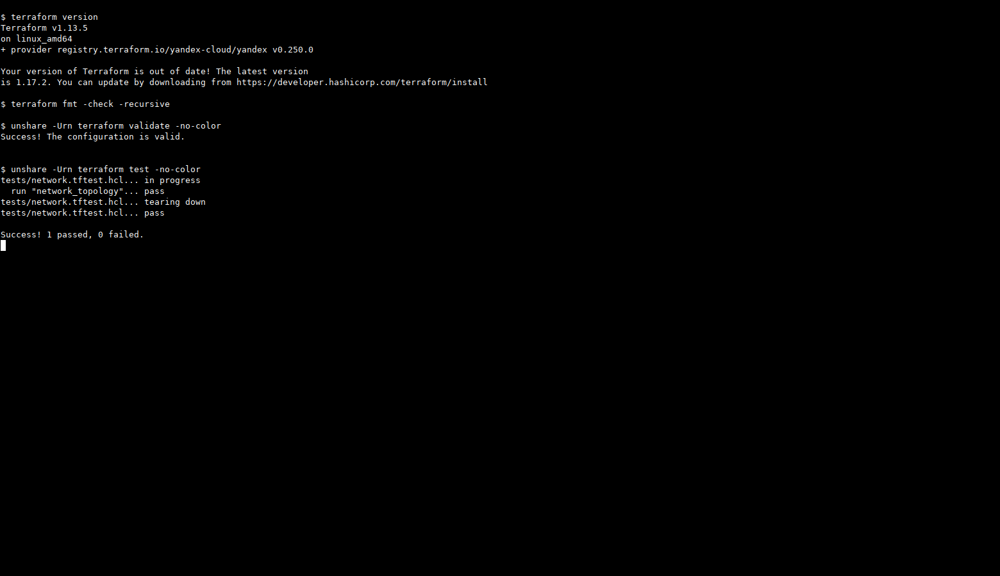
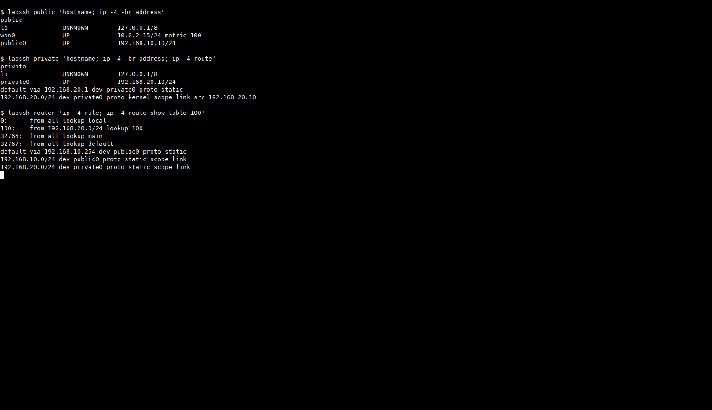
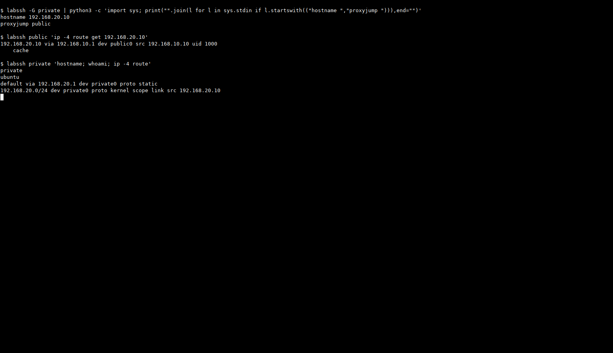
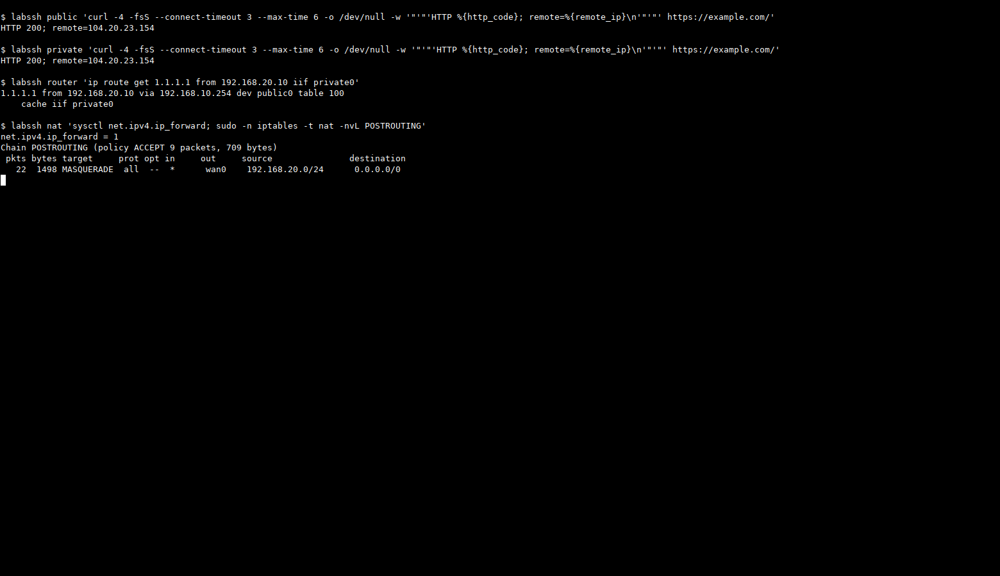
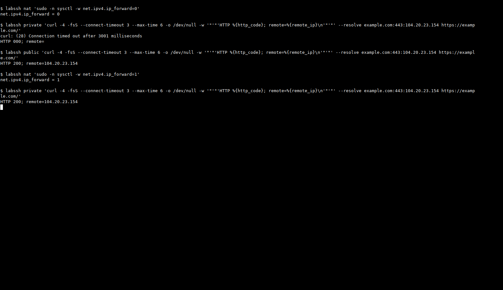

# Домашнее задание «Организация сети»

Схему из задания описал в Terraform для Yandex Cloud. Маршрутизацию, NAT и SSH проверил на отдельном локальном стенде QEMU/KVM. Скриншоты сетевых проверок ниже относятся к этому стенду; облачный `terraform apply` не выполнялся.

## 1. Конфигурация Yandex Cloud

Код находится в [terraform](terraform). В нём описаны:

- одна VPC `clopro-15-1`;
- подсеть `public` — `192.168.10.0/24`;
- NAT-инстанс в public с внутренним адресом `192.168.10.254` и публичным IP;
- отдельная public VM с публичным IP;
- подсеть `private` — `192.168.20.0/24`;
- таблица маршрутов с `0.0.0.0/0 → 192.168.10.254`, привязанная только к private;
- private VM без публичного IP.

Для NAT оставил **точный image_id из условия — `fd80mrhj8fl2oe87o4e1`**. Для двух обычных VM используется семейство Ubuntu 22.04 LTS.

Входящий SSH к public ограничен параметром `admin_cidr`. Private принимает SSH только от группы безопасности public VM. NAT принимает транзитный трафик приватной подсети. В [outputs.tf](terraform/outputs.tf) описаны адреса и команда подключения к private через `ssh -J` — без переноса приватного ключа на промежуточный сервер.

## 2. Проверка Terraform

Использовал Terraform **1.13.5** и провайдер `yandex-cloud/yandex` **0.250.0**. Версия провайдера закреплена в коде и [lock-файле](terraform/.terraform.lock.hcl).

Выполнил:

```bash
terraform init -backend=false -lockfile=readonly -input=false
terraform fmt -check -recursive
unshare -Urn terraform validate -no-color
unshare -Urn terraform test -no-color
```

`validate` прошёл. Тест [network.tftest.hcl](terraform/tests/network.tftest.hcl) завершился с результатом **1 passed, 0 failed**. Он проверяет точные CIDR, три VM, адрес и образ NAT, привязку таблицы маршрутов, отсутствие публичного IP у private и правила SSH.

В тесте используется **mock provider**. Проверка выполнялась в отдельном сетевом namespace без внешней сети: это проверка конфигурации, а не создание ресурсов через API облака.



## 3. Тестовый сетевой стенд

Для проверки самой схемы поднял четыре VM с Ubuntu 20.04:

| VM | Адрес в учебной сети | Назначение |
|---|---|---|
| public | 192.168.10.10/24 | Публичный сервер и SSH jump host |
| nat | 192.168.10.254/24 | Пересылка пакетов и MASQUERADE |
| private | 192.168.20.10/24 | Сервер без отдельного внешнего интерфейса |
| router | 192.168.10.1/24 и 192.168.20.1/24 | Аналог встроенного маршрутизатора VPC для теста |

Внешнее подключение public и NAT организовано через QEMU user-mode networking. Адрес `10.0.2.15`, видимый внутри этих VM, — адрес эмулятора, **не публичный IP Yandex Cloud**. У private есть только loopback и интерфейс `private0`.

На private шлюзом является `192.168.20.1`. Служебный router обрабатывает трафик от `192.168.20.0/24` по таблице 100, где default route направлен на `192.168.10.254`. То есть на роль следующего узла назначен именно NAT, а не внешний интерфейс router. Обратные маршруты между подсетями настроены отдельно.



Код создания и описание стенда: [local-lab](local-lab/README.md). Он использует исходный cloud image как backing image, а все изменения хранит в отдельных временных дисках.

## 4. Подключение к private через public

Для private настроил `ProxyJump public`. Проверил конфигурацию SSH, маршрут с public к `192.168.20.10` и подключение: удалённая машина вернула hostname `private` и пользователя `ubuntu`. Прямого SSH-проброса с хоста к private нет.

В командах на скриншотах `labssh` — сокращение для `ssh -F <конфигурация стенда>`.



## 5. Выход в интернет через NAT

С public и private выполнил HTTPS-запросы к `https://example.com/`. Обе машины получили **HTTP 200**.

На NAT проверил `net.ipv4.ip_forward = 1` и правило MASQUERADE для источника `192.168.20.0/24`. У правила увеличиваются счётчики пакетов. На router команда `ip route get` для пакета из private показывает next hop `192.168.10.254` и таблицу 100.



Одного успешного curl было недостаточно, чтобы проверить зависимость от NAT. Поэтому дополнительно отключил IPv4 forwarding на NAT, повторил запросы и включил его обратно:

| Состояние NAT | public → интернет | private → интернет |
|---|---|---|
| Forwarding включён | HTTP 200 | HTTP 200 |
| Forwarding выключен | HTTP 200 | Таймаут, curl exit 28 |
| Forwarding включён обратно | — | HTTP 200 |

В отрицательной проверке зафиксировал адрес сервера через `curl --resolve`. Это исключает ошибку DNS как причину таймаута. После включения forwarding доступ восстановился.



Проверку выполняет [verify.py](local-lab/verify.py); он восстанавливает forwarding в `finally`. Исходные результаты прогона находятся в [local-verification.json](results/local-verification.json).

## Что подтверждено

- Terraform прошёл форматирование, проверку схемы и mock-тест топологии.
- На локальном стенде проверены обе подсети, SSH через public, маршрут на NAT, выход в интернет и потеря/восстановление доступа private при выключении/включении NAT.
- Развёртывание именно в Yandex Cloud и доступность заданного NAT-образа в облаке этими проверками не подтверждены.
- После проверки четыре временные VM штатно выключены, их диски и ключи удалены. Исходный образ сохранён.

Необязательную часть AWS в эту работу не включал.
