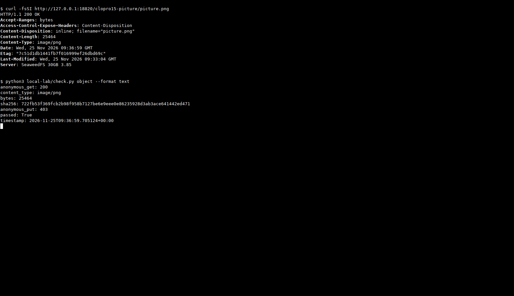
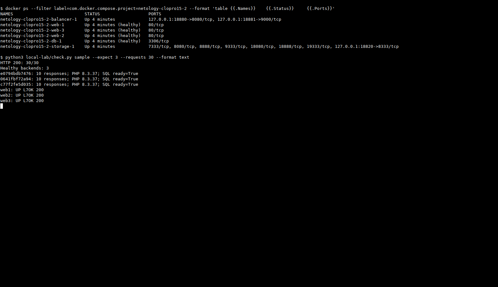
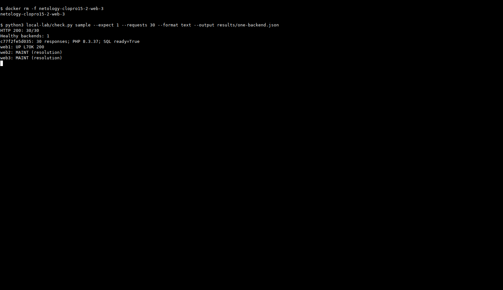
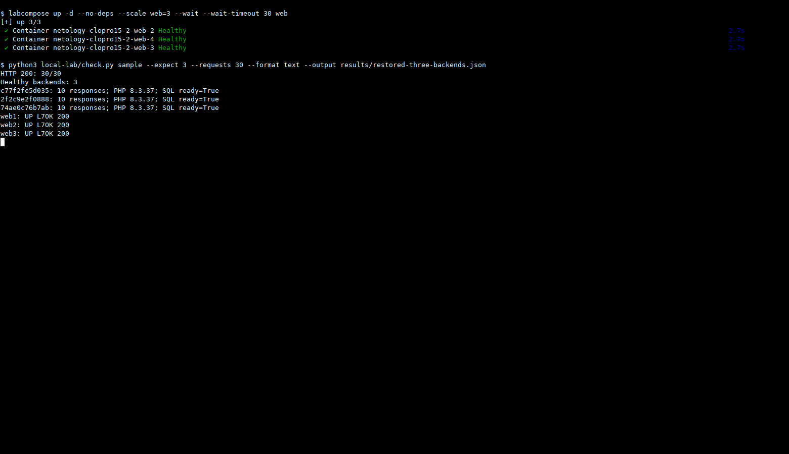
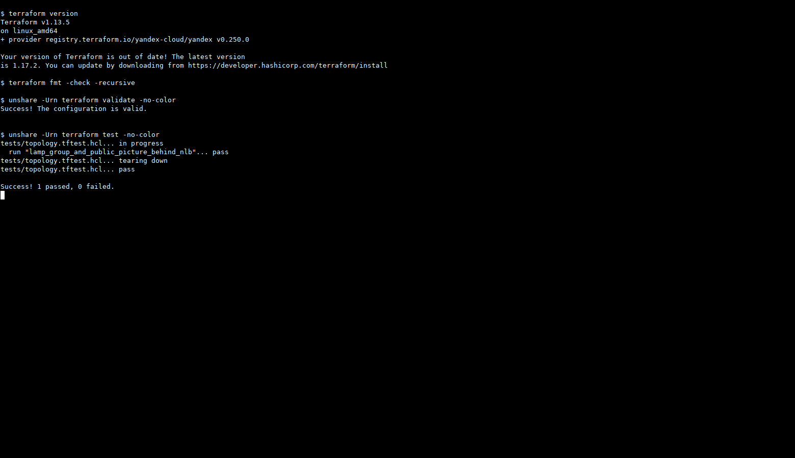

# Домашнее задание «Вычислительные мощности. Балансировщики нагрузки»

Схема состоит из бакета с картинкой, группы из трёх LAMP-серверов и сетевого балансировщика. Каждый сервер отдаёт страницу со ссылкой на один и тот же объект, а балансировщик направляет подключения на доступные узлы.

## 1. Object Storage

В [Terraform](terraform/main.tf) описаны бакет и объект `picture.png`. Для объекта задан `Content-Type: image/png` и публичное чтение. Просмотр списка объектов и конфигурации бакета анонимным пользователям не разрешён.

Для загрузки создаются отдельный сервисный аккаунт, роль `storage.admin` и статический S3-ключ. Ключ передаётся ресурсам бакета и объекта через ссылки Terraform, без записи в исходники или outputs. Файлы state и реальные переменные исключены из Git.

Картинка — [assets/picture.png](assets/picture.png). Проверил её получение без авторизации: HTTP 200, тип `image/png`, размер 25 464 байта. SHA256 полученных данных совпал с исходным PNG. Попытка записи без ключа вернула HTTP 403.

## 2. Группа из трёх LAMP-серверов

Группа использует существующую публичную подсеть, ID которой передаётся в `public_subnet_id`. Для шаблона оставил рекомендованный образ **`fd827b91d99psvq5fjit`**. Размер группы задан через `fixed_scale.size = 3`.

Через [cloud-init](terraform/cloud-init.yaml.tftpl) устанавливаются два файла:

- [index.php](app/index.php) — страница с hostname сервера и ссылкой на картинку;
- [health.php](app/health.php) — проверка состояния для группы и балансировщика.

URL картинки формируется из имени бакета и ключа объекта, затем подставляется в стартовую страницу. Загрузка объекта и назначение ролей сервисному аккаунту входят в зависимости группы.

HTTP открыт на порту 80, SSH ограничен параметром `admin_cidr`. В группе настроена собственная HTTP-проверка `/health.php`.

## 3. Сетевой балансировщик

В конфигурации создан внешний Network Load Balancer с TCP listener на порту 80. Его target group берётся из Instance Group, поэтому состав группы не приходится дублировать вручную.

Для NLB настроена HTTP-проверка `/health.php`: интервал 5 секунд, timeout 2 секунды, по две успешные или неуспешные проверки для изменения состояния узла.

## 4. Проверка распределения запросов

Для серии проверок использовал отдельный Docker-стенд: три Apache/PHP backend, MariaDB, S3-совместимый SeaweedFS и HAProxy с TCP listener и HTTP health checks. Конфигурация и повторяемый запуск находятся в [local-lab](local-lab/README.md).

Страница возвращает заголовок `X-Backend-Id` и hostname в HTML. Так можно проверить, что ответы действительно приходят от разных серверов, а не просто несколько раз получить одинаковую страницу.

В первом прогоне выполнил 30 запросов через один адрес балансировщика. Получил 30 ответов HTTP 200 — по 10 от каждого сервера. Отдельно проверил SQL-соединение каждого backend: `SELECT 1` выполнился успешно.

При проверке открывал новое TCP-соединение для каждого запроса. Для L4-балансировщика это существенно: несколько HTTP-запросов внутри одного keep-alive соединения могут оставаться на одном сервере.

## 5. Удаление серверов и восстановление группы

Удалил один сервер. После того как health checks исключили его из обработки, повторил серию: 30 ответов HTTP 200, по 15 от двух оставшихся серверов.

Затем удалил второй сервер. Все 30 запросов успешно обработал оставшийся backend. Адрес, по которому выполнялись запросы, не менялся.

После проверки восстановил размер группы до трёх и повторил запросы. Снова получил три различных backend и распределение 10 / 10 / 10. В проверочном стенде восстановление выполнено командой Compose; параметры облачной группы находятся в Terraform.

| Этап | Доступных серверов | Успешных ответов | Распределение |
|---|---:|---:|---|
| Исходная группа | 3 | 30 из 30 | 10 / 10 / 10 |
| После удаления одного | 2 | 30 из 30 | 15 / 15 |
| После удаления второго | 1 | 30 из 30 | 30 |
| После восстановления | 3 | 30 из 30 | 10 / 10 / 10 |

Серии запросов собирались после схождения health checks. Исходные результаты: [Object Storage](results/object-storage.json), [три сервера](results/three-backends.json), [два сервера](results/two-backends.json), [один сервер](results/one-backend.json), [восстановленная группа](results/restored-three-backends.json).

## 6. Проверка Terraform

Использовал Terraform **1.13.5** и провайдер `yandex-cloud/yandex` **0.250.0**. Выполнил `init`, `fmt -check`, `validate` и `terraform test`.

Тест с `mock_provider` проверяет публичное чтение картинки, S3-учётные данные, образ LAMP, размер группы, подсеть, роли, содержимое cloud-init, target group и HTTP health checks. `validate` и тест запускались в отдельном сетевом namespace. Результат — **1 passed, 0 failed**.

Код: [main.tf](terraform/main.tf), [variables.tf](terraform/variables.tf), [outputs.tf](terraform/outputs.tf), [пример переменных](terraform/terraform.tfvars.example), [тест](terraform/tests/topology.tftest.hcl).

Дополнительные задания с Application Load Balancer и AWS в эту работу не включал.
