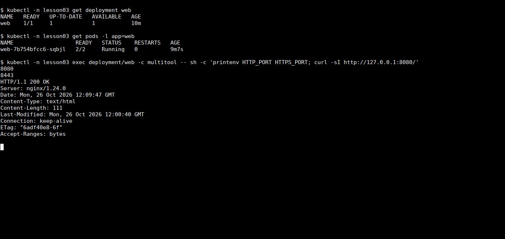
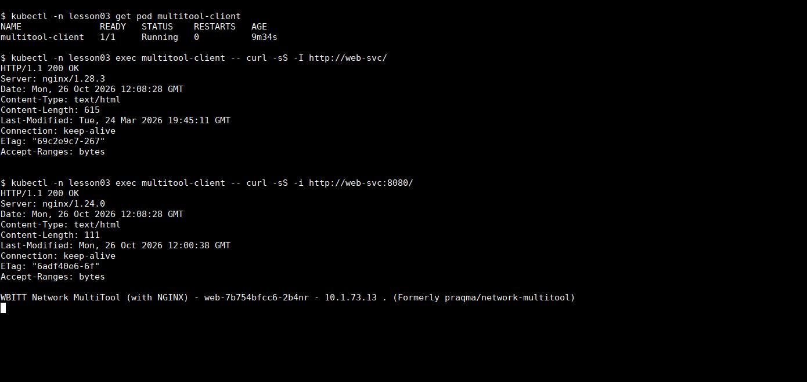
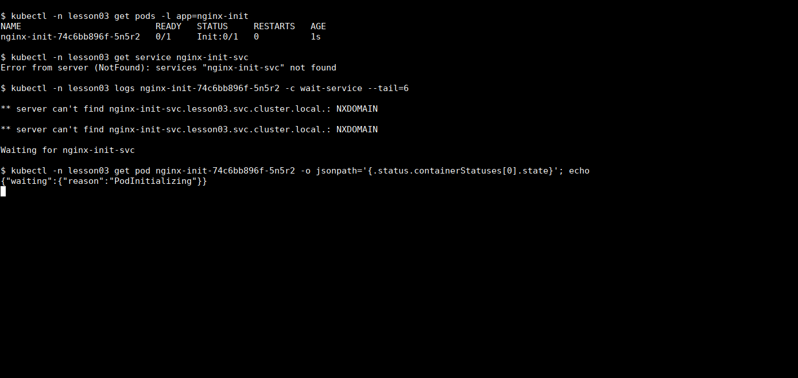
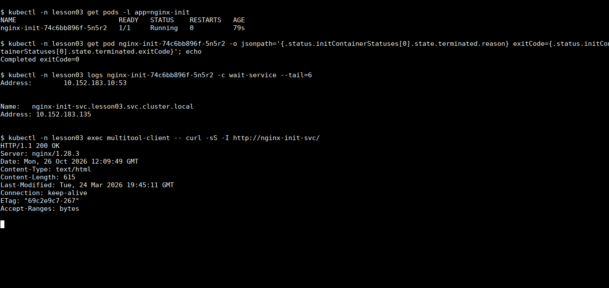

# Домашнее задание «Запуск приложений в K8S»

## Задание 1. Deployment с nginx и multitool

Создал Deployment `web` с двумя контейнерами: `nginx:1.28-alpine` и `wbitt/network-multitool:alpine-extra`. Для этой работы использовал отдельный namespace `lesson03` в локальном MicroK8s.

При первом запуске multitool начал перезапускаться. В его логах была ошибка:

```text
bind() to 0.0.0.0:80 failed (98: Address in use)
```

Оказалось, что multitool тоже запускает веб-сервер. Контейнеры одного Pod используют общую сеть, поэтому оба пытались слушать порт 80. Одного изменения `containerPort` недостаточно: это поле не перенастраивает приложение. В контейнер multitool добавил переменные `HTTP_PORT=8080` и `HTTPS_PORT=8443`, а nginx оставил на порту 80.


После исправления проверил одну реплику. У Pod оба контейнера готовы — `2/2`, веб-сервер multitool отвечает на новом порту.



Затем увеличил количество реплик до двух:

```bash
kubectl -n lesson03 scale deployment/web --replicas=2
kubectl -n lesson03 rollout status deployment/web
kubectl -n lesson03 get pods -l app=web
```

Создал Service `web-svc`. Он выбирает Pod по метке `app: web` и открывает два порта: `80` для nginx и `8080` для multitool. В EndpointSlice видны адреса обеих реплик.


Для проверки доступа создал отдельный Pod `multitool-client`. Из него выполнил:

```bash
kubectl -n lesson03 exec multitool-client -- curl -sS -I http://web-svc/
kubectl -n lesson03 exec multitool-client -- curl -sS -i http://web-svc:8080/
```

Оба запроса вернули `HTTP/1.1 200 OK`. На порту 8080 в ответе также видно имя Pod, который обработал запрос. Дополнительно проверил оба порта каждой реплики напрямую по Pod IP — все четыре запроса завершились с кодом 200.



Манифесты:

- [deployment.yaml](deployment.yaml) — исправленный Deployment, сохранён с двумя репликами;
- [service.yaml](service.yaml) — Service для nginx и multitool;
- [client.yaml](client.yaml) — отдельный Pod для проверки.

## Задание 2. Ожидание Service через init-контейнер

Создал Deployment `nginx-init`. Перед основным контейнером запускается init-контейнер `busybox:1.37`, который проверяет DNS-имя будущего Service:

```sh
until nslookup "nginx-init-svc.${POD_NAMESPACE}.svc.cluster.local."; do
  echo "Waiting for nginx-init-svc"
  sleep 2
done
```

Namespace передаётся в `POD_NAMESPACE` через `metadata.namespace`. Сначала пробовал короткое имя сервиса, но BusyBox получал дополнительные NXDOMAIN при переборе DNS-суффиксов, и цикл не завершался даже после появления Service. Поэтому указал полное имя с точкой на конце.

Сначала применил только Deployment, без Service:

```bash
kubectl -n lesson03 apply -f init-deployment.yaml
kubectl -n lesson03 get pods -l app=nginx-init
```

Pod остался в состоянии `Init:0/1`. В логах init-контейнера — `Waiting for nginx-init-svc`, а основной nginx ожидает с причиной `PodInitializing`.



После этого создал Service:

```bash
kubectl -n lesson03 apply -f init-service.yaml
kubectl -n lesson03 rollout status deployment/nginx-init
```

DNS-имя разрешилось, init-контейнер завершился с `Completed`, `exitCode=0`, и nginx запустился. Pod перешёл в `1/1 Running`. Запрос из `multitool-client` к `http://nginx-init-svc/` вернул HTTP 200.



Здесь проверяется именно появление Service в DNS, а не готовность HTTP-приложения. Если бы init-контейнер ждал HTTP-ответ от nginx в этом же Pod, получилось бы замкнутое ожидание: nginx не может запуститься до завершения init.

Манифесты:

- [init-deployment.yaml](init-deployment.yaml) — nginx с ожидающим init-контейнером;
- [init-service.yaml](init-service.yaml) — Service, после создания которого разрешается запуск.

Все команды выполнялись в namespace `lesson03`; создать его можно командой `kubectl create namespace lesson03`. Для повторения второго задания Service нужно создавать после фиксации состояния `Init:0/1`, а не применять все манифесты разом.
