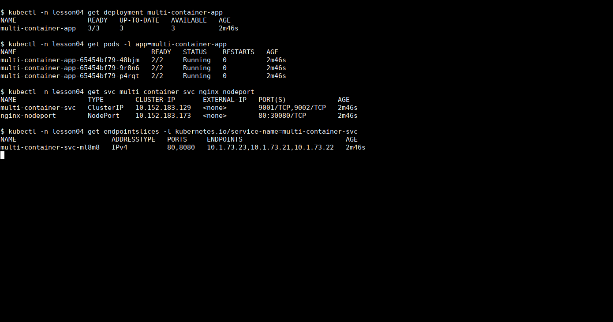
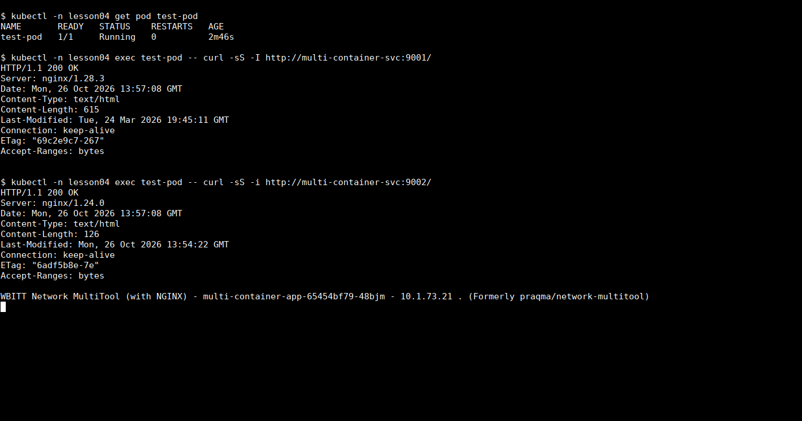
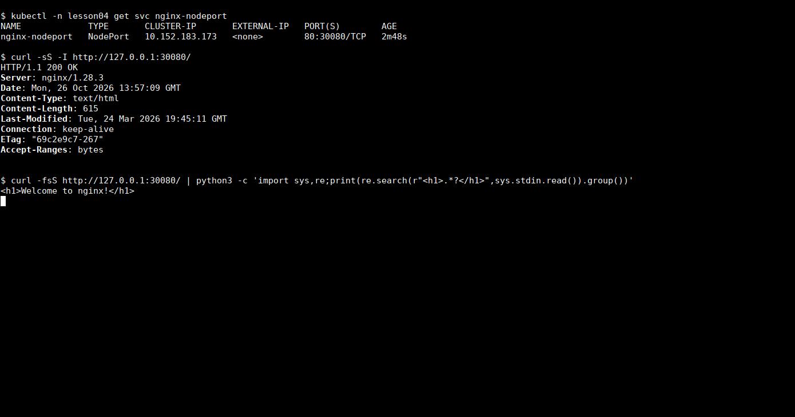
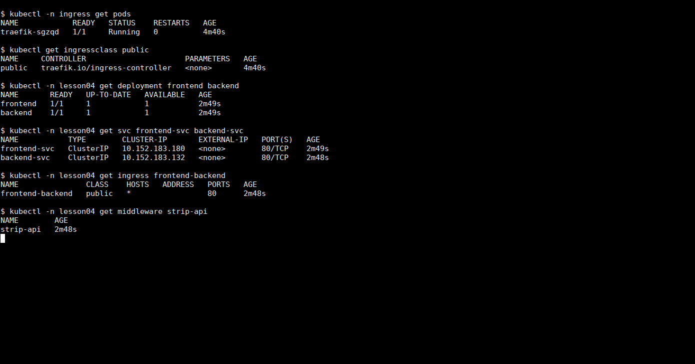
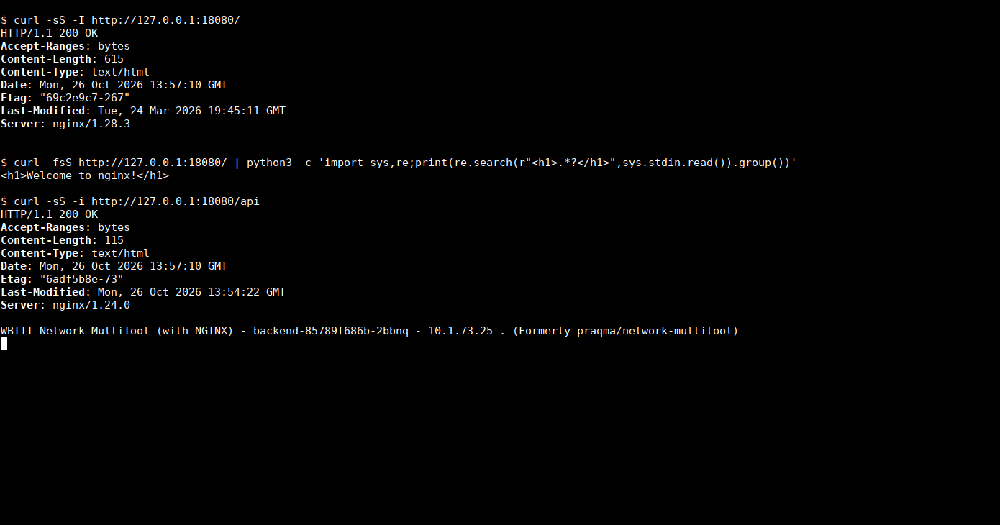

# Домашнее задание «Сетевое взаимодействие в Kubernetes»

## Задание 1. ClusterIP и NodePort

Создал Deployment `multi-container-app` с тремя репликами. В каждом Pod работают nginx на порту 80 и multitool на 8080. Порт multitool задал через `HTTP_PORT`, чтобы он не конфликтовал с nginx. Для HTTPS multitool также указал отдельный порт 8443.

Для работы выделил namespace `lesson04` в локальном MicroK8s.

```bash
kubectl create namespace lesson04
kubectl -n lesson04 apply -f deployment-multi-container.yaml
kubectl -n lesson04 apply -f service-clusterip.yaml -f service-nodeport.yaml
kubectl -n lesson04 rollout status deployment/multi-container-app
```

Service `multi-container-svc` имеет тип ClusterIP и два порта:

| Порт Service | Куда направляется запрос |
| --- | --- |
| 9001 | nginx, порт 80 |
| 9002 | multitool, порт 8080 |

Оба порта используют один селектор `app: multi-container-app`. В EndpointSlice видны адреса всех трёх реплик, у каждого Pod готовы оба контейнера — `2/2`.



### Доступ внутри кластера

Создал отдельный Pod для проверок:

```bash
kubectl -n lesson04 run test-pod \
  --image=wbitt/network-multitool:alpine-extra \
  --restart=Never --command -- sleep 3600

kubectl -n lesson04 exec test-pod -- curl -sS -I http://multi-container-svc:9001/
kubectl -n lesson04 exec test-pod -- curl -sS -i http://multi-container-svc:9002/
```

Оба запроса вернули HTTP 200. На порту 9001 отвечает nginx, на 9002 — multitool с именем обработавшего запрос Pod. Дополнительно обратился к каждой реплике напрямую по её Pod IP на портах 80 и 8080: все шесть запросов прошли.



### Доступ с локального компьютера

Для nginx создал отдельный Service `nginx-nodeport` с `nodePort: 30080`. Он выбирает те же три реплики и направляет запросы на порт nginx.

Кластер работает в VM с NAT. Поэтому на время проверки настроил сетевой проброс гипервизора:

```text
Хост 127.0.0.1:30080 → узел Kubernetes 10.0.2.15:30080 → nginx:80
```

Запрос выполнил с хоста, не из Pod и не через `kubectl port-forward`:

```bash
curl -i http://127.0.0.1:30080/
```

Получил HTTP 200 и страницу `Welcome to nginx!`. На скриншоте отдельно показал заголовки и заголовок страницы, чтобы не занимать весь экран HTML-кодом. Если IP узла доступен напрямую, без NAT, адрес проверки — `http://<node-ip>:30080/`.



Манифесты:

- [deployment-multi-container.yaml](deployment-multi-container.yaml);
- [service-clusterip.yaml](service-clusterip.yaml);
- [service-nodeport.yaml](service-nodeport.yaml).

## Задание 2. Ingress для frontend и backend

Развернул два отдельных Deployment: `frontend` с nginx и `backend` с multitool. Для каждого создал Service типа ClusterIP на порту 80.

Включил контроллер:

```bash
microk8s enable ingress
```

В моём MicroK8s 1.35 эта команда устанавливает Traefik. Поэтому в Ingress указал класс `public`, а вместо nginx-аннотации `rewrite-target` из шаблона использовал Middleware `strip-api` для Traefik.

Ingress содержит два маршрута:

- `/` → `frontend-svc:80`;
- `/api` → `backend-svc:80`.

Middleware убирает префикс `/api` перед передачей запроса приложению. Это нужно, потому что стандартная страница multitool находится на `/`. Для запроса к frontend префикс не совпадает, и путь остаётся без изменений.

```bash
kubectl -n lesson04 apply -f deployment-frontend.yaml -f deployment-backend.yaml
kubectl -n lesson04 apply -f service-frontend.yaml -f service-backend.yaml
kubectl -n lesson04 apply -f middleware.yaml -f ingress.yaml
kubectl -n lesson04 get ingress
```

Контроллер и оба приложения запущены:



Для проверки с хоста временно пробросил `127.0.0.1:18080` на порт 80 узла VM, где принимает запросы Ingress-контроллер. Правило Ingress не ограничено доменом.

```bash
curl -i http://127.0.0.1:18080/
curl -i http://127.0.0.1:18080/api
```

По `/` получил HTTP 200 и страницу nginx. По `/api` — HTTP 200 и ответ multitool с именем Pod `backend-...`. Также проверил `/api/`: он попадает в backend.



Манифесты:

- [deployment-frontend.yaml](deployment-frontend.yaml);
- [deployment-backend.yaml](deployment-backend.yaml);
- [service-frontend.yaml](service-frontend.yaml);
- [service-backend.yaml](service-backend.yaml);
- [ingress.yaml](ingress.yaml);
- [middleware.yaml](middleware.yaml) — удаление префикса `/api` для Traefik.

Middleware и Ingress рассчитаны на namespace `lesson04`. Для повторения нужна установка addon `ingress` с Traefik и его CRD.

После проверок удалил тестовый Pod и убрал два временных NAT-проброса. Порты слушали только localhost; доступ из интернета не открывал. Приложения и их манифесты оставил для следующих занятий.
