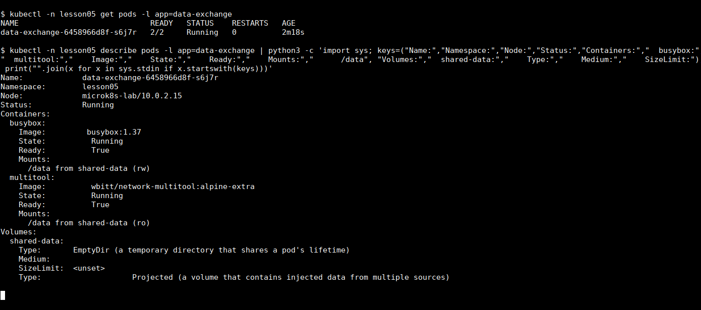
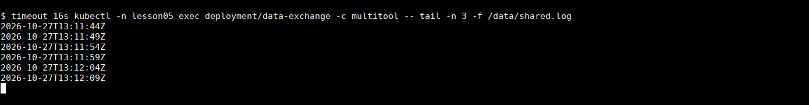
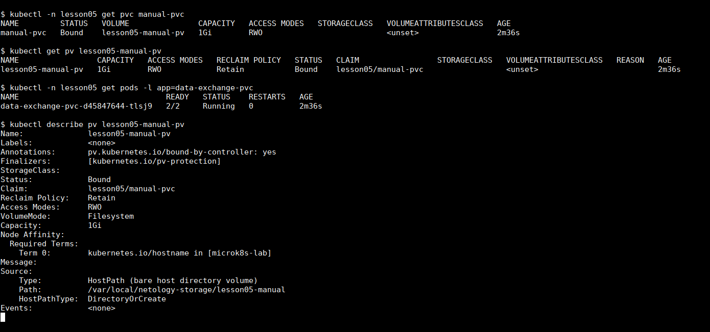
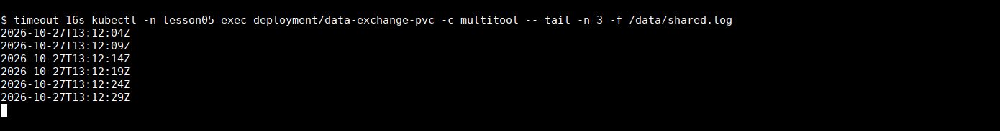
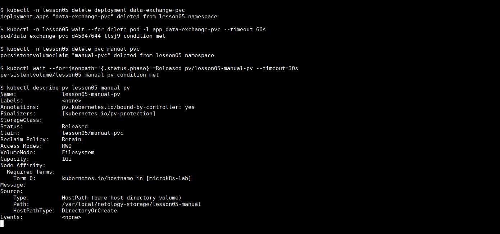
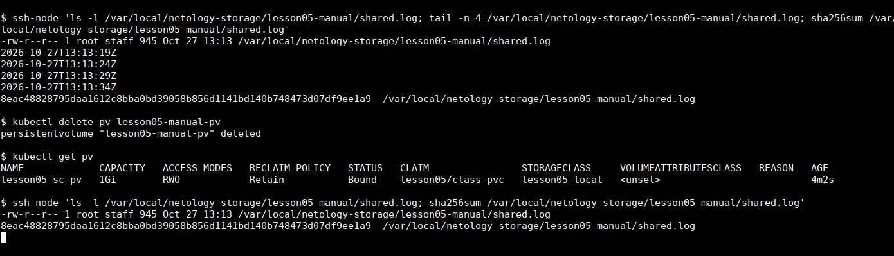
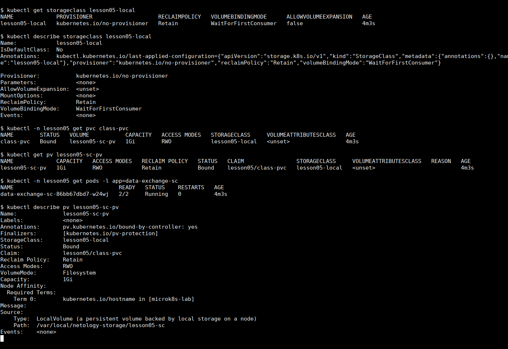
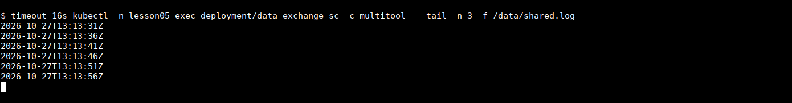

# Домашнее задание «Хранение в K8s»

Проверял в локальном MicroK8s, в namespace `lesson05`. Во всех трёх вариантах busybox дописывает время в `/data/shared.log` каждые пять секунд, а multitool читает этот файл. В multitool том подключён только для чтения.

## Задание 1. Общий том между контейнерами

Манифест: [containers-data-exchange.yaml](containers-data-exchange.yaml).

Создал Deployment `data-exchange` с контейнерами busybox и multitool. Оба используют один `emptyDir`, подключённый в `/data`.

```bash
kubectl create namespace lesson05
kubectl apply -n lesson05 -f containers-data-exchange.yaml
kubectl describe pods -n lesson05 -l app=data-exchange
```

В описании Pod видно оба контейнера, общий том `shared-data` типа `EmptyDir` и его подключение: `rw` у busybox, `ro` у multitool. На скриншоте вывод описания сокращён до этих разделов.



Запустил чтение из multitool:

```bash
kubectl exec -n lesson05 deployment/data-exchange -c multitool -- \
  tail -n 3 -f /data/shared.log
```

Новые строки появляются с интервалом пять секунд. На скриншотах с `tail -f` использовал `timeout 16s`, чтобы показать несколько обновлений и завершить наблюдение.



`emptyDir` подходит для обмена данными между контейнерами одного Pod. При удалении самого Pod данные этого тома теряются.

## Задание 2. Ручной PV и PVC

Манифест: [pv-pvc.yaml](pv-pvc.yaml). В одном файле находятся PV, PVC и Deployment.

Создал PV `lesson05-manual-pv` объёмом `1Gi` с политикой `Retain`. Для хранения использовал каталог `/var/local/netology-storage/lesson05-manual` на ноде. PVC `manual-pvc` явно ссылается на этот PV, без StorageClass. В Deployment `data-exchange-pvc` заменил `emptyDir` на подключение PVC.

```bash
kubectl apply -n lesson05 -f pv-pvc.yaml
kubectl get pv lesson05-manual-pv
kubectl get pvc -n lesson05 manual-pvc
kubectl get pods -n lesson05 -l app=data-exchange-pvc
```

PV и PVC получили статус `Bound`, оба контейнера запустились.



Проверил чтение файла через multitool:

```bash
kubectl exec -n lesson05 deployment/data-exchange-pvc -c multitool -- \
  tail -n 3 -f /data/shared.log
```



### Удаление ресурсов и сохранность данных

Сначала удалил Deployment и дождался удаления его Pod, затем удалил PVC:

```bash
kubectl delete deployment -n lesson05 data-exchange-pvc
kubectl wait -n lesson05 --for=delete pod -l app=data-exchange-pvc --timeout=60s
kubectl delete pvc -n lesson05 manual-pvc
kubectl describe pv lesson05-manual-pv
```

PV остался, но перешёл из `Bound` в `Released`. В описании сохранилась ссылка на удалённый PVC. При политике `Retain` такой том не возвращается автоматически в пул свободных томов: для повторного использования нужно отдельно подготовить PV и разобраться с оставшимися данными.



Перед удалением PV проверил файл на ноде и посчитал SHA-256. Писавший контейнер к этому моменту уже был удалён, поэтому файл больше не менялся. Затем удалил PV:

```bash
kubectl delete pv lesson05-manual-pv
```

Повторная проверка на ноде:

```bash
ls -l /var/local/netology-storage/lesson05-manual/shared.log
tail -n 5 /var/local/netology-storage/lesson05-manual/shared.log
sha256sum /var/local/netology-storage/lesson05-manual/shared.log
```

На скриншоте эти команды выполнены по SSH через локальную обёртку `ssh-node`. Файл остался на месте, размер и SHA-256 до и после удаления PV совпали. Удаление объекта PV в данном случае не удалило каталог `hostPath` и его содержимое.



## Задание 3. Свой StorageClass

Манифест: [sc.yaml](sc.yaml). В нём описаны StorageClass `lesson05-local`, local PV, PVC и Deployment.

Взял `kubernetes.io/no-provisioner`, как в примере задания. Он не создаёт том автоматически, поэтому добавил свой PV с `storageClassName: lesson05-local`. Для local PV указал `nodeAffinity` на ноду `microk8s-lab`. Это имя моей ноды, а не универсальное значение для любого кластера.

Каталог для local PV заранее создал на ноде:

```bash
sudo mkdir -p /var/local/netology-storage/lesson05-sc
```

Дальше применил манифест и проверил ресурсы:

```bash
kubectl apply -n lesson05 -f sc.yaml
kubectl get storageclass lesson05-local
kubectl get pv lesson05-sc-pv
kubectl get pvc -n lesson05 class-pvc
kubectl get pods -n lesson05 -l app=data-exchange-sc
```

У класса задано `WaitForFirstConsumer`: привязка тома учитывает Pod, которому он нужен. PVC `class-pvc` связался с `lesson05-sc-pv`, Pod запустился с двумя готовыми контейнерами.



Проверил тот же файл из multitool:

```bash
kubectl exec -n lesson05 deployment/data-exchange-sc -c multitool -- \
  tail -n 3 -f /data/shared.log
```



Строки продолжают появляться раз в пять секунд. В отличие от первого варианта с `emptyDir`, здесь файл находится в отдельном каталоге ноды, подключённом через PV и PVC.
