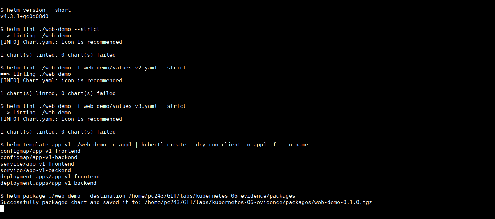
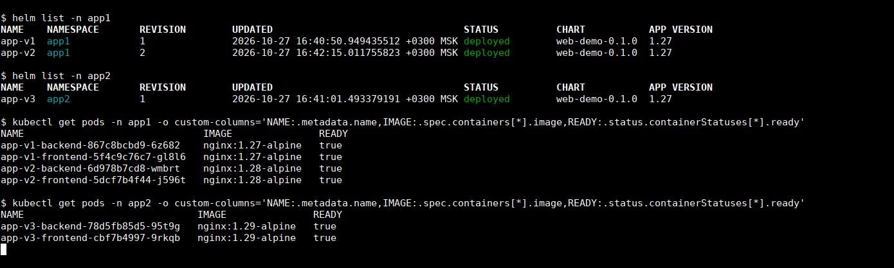
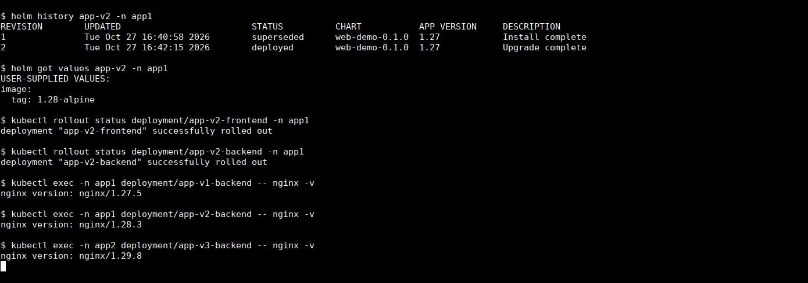
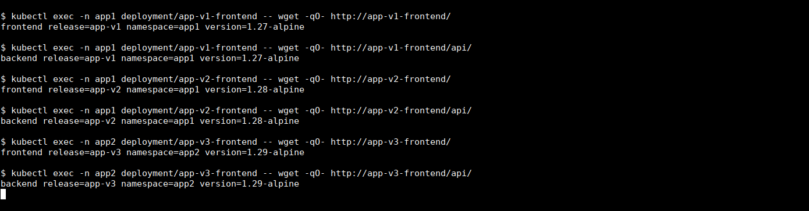

# Домашнее задание «Helm»

## Задание 1. Подготовка чарта

Собрал чарт [web-demo](web-demo) для небольшого приложения из frontend и backend. Каждый компонент запускается отдельным Deployment и получает свой Service. Frontend отвечает на `/`, а запросы `/api/` передаёт в backend.

В ответах добавил имя релиза, namespace и тег образа. Так при проверке видно, какая именно копия приложения ответила.

Файлы чарта:

- [Chart.yaml](web-demo/Chart.yaml) — описание чарта;
- [values.yaml](web-demo/values.yaml) — образ, число реплик, порт Service и ресурсы контейнеров;
- [deployment.yaml](web-demo/templates/deployment.yaml) — Deployment для каждого компонента;
- [service.yaml](web-demo/templates/service.yaml) — их Services;
- [configmap.yaml](web-demo/templates/configmap.yaml) — конфигурация nginx;
- [values-v2.yaml](web-demo/values-v2.yaml) и [values-v3.yaml](web-demo/values-v3.yaml) — переопределение версии образа.

Версию менял через `image.tag` в values. По умолчанию это `1.27-alpine`, для второй и третьей копии — `1.28-alpine` и `1.29-alpine`. Сам чарт во всех случаях один, версии `0.1.0`.

Имена объектов и селекторы содержат имя Helm-релиза. Поэтому две установки одного чарта в одном namespace не используют чужие Pod. В конфигурации frontend имя backend тоже привязано к своему релизу.

Проверял в локальном MicroK8s, Helm установлен локально. Команды выполнял из каталога этой работы:

```bash
helm version --short
helm lint ./web-demo --strict
helm lint ./web-demo -f web-demo/values-v2.yaml --strict
helm lint ./web-demo -f web-demo/values-v3.yaml --strict
helm template app-v1 ./web-demo -n app1
helm package ./web-demo
```

Все три проверки `lint` прошли. Из шаблонов получаются два Deployment, два Service и два ConfigMap. Сгенерированные манифесты также прошли `kubectl apply --dry-run=server` для каждого варианта values. Архив чарта собрался без ошибок.



## Задание 2. Три установки в двух namespace

Создал namespace `app1` и `app2`. Сначала установил две копии исходной версии в `app1`, затем третью версию в `app2`:

```bash
kubectl create namespace app1
kubectl create namespace app2

helm install app-v1 ./web-demo -n app1 --wait --timeout 180s
helm install app-v2 ./web-demo -n app1 --wait --timeout 180s
helm install app-v3 ./web-demo -n app2 \
  -f web-demo/values-v3.yaml --wait --timeout 180s
```

После этого обновил только `app-v2`, передав файл с другим тегом образа:

```bash
helm upgrade app-v2 ./web-demo -n app1 \
  -f web-demo/values-v2.yaml --wait --timeout 180s
```

Итоговое размещение:

| Релиз | Namespace | Образ обоих компонентов | Версия nginx внутри контейнера |
| --- | --- | --- | --- |
| `app-v1` | `app1` | `nginx:1.27-alpine` | `1.27.5` |
| `app-v2` | `app1` | `nginx:1.28-alpine` | `1.28.3` |
| `app-v3` | `app2` | `nginx:1.29-alpine` | `1.29.8` |

Проверил релизы и Pod:

```bash
helm list -n app1
helm list -n app2
kubectl get pods -n app1
kubectl get pods -n app2
```

Все три релиза в статусе `deployed`. Работают шесть Pod: по frontend и backend на релиз. Контейнеры готовы, перезапусков нет.

В `helm list` колонка `APP VERSION` берётся из `Chart.yaml` и остаётся `1.27`. Фактические версии образов видны в выводе `kubectl` ниже; отдельно проверил их командой `nginx -v`.



История `app-v2` содержит установку и обновление. Во второй ревизии изменился `image.tag`, оба Deployment успешно завершили rollout. У остальных релизов сохранились свои версии.

```bash
helm history app-v2 -n app1
helm get values app-v2 -n app1
kubectl rollout status deployment/app-v2-frontend -n app1
kubectl rollout status deployment/app-v2-backend -n app1
```



### Проверка ответов приложения

Обратился к каждому frontend через его Service, сначала к `/`, затем к `/api/`. Например, для второй версии:

```bash
kubectl exec -n app1 deployment/app-v2-frontend -- \
  wget -qO- http://app-v2-frontend/
kubectl exec -n app1 deployment/app-v2-frontend -- \
  wget -qO- http://app-v2-frontend/api/
```

Получил:

```text
frontend release=app-v2 namespace=app1 version=1.28-alpine
backend release=app-v2 namespace=app1 version=1.28-alpine
```

Такие же запросы выполнил для `app-v1` и `app-v3`. Во всех ответах совпали ожидаемые имя релиза, namespace и версия. Запрос `/api/` попадал в backend своего релиза.


