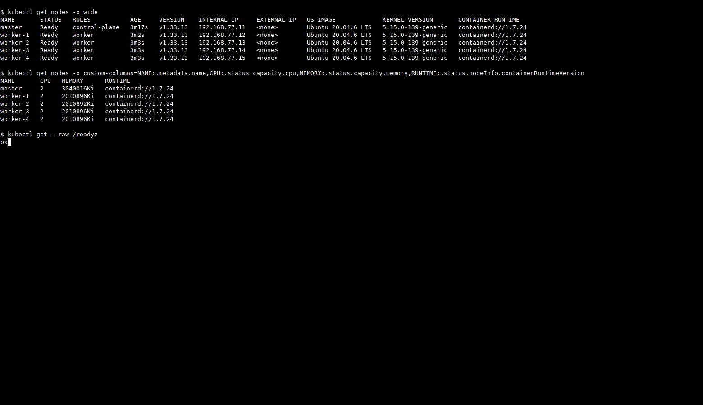
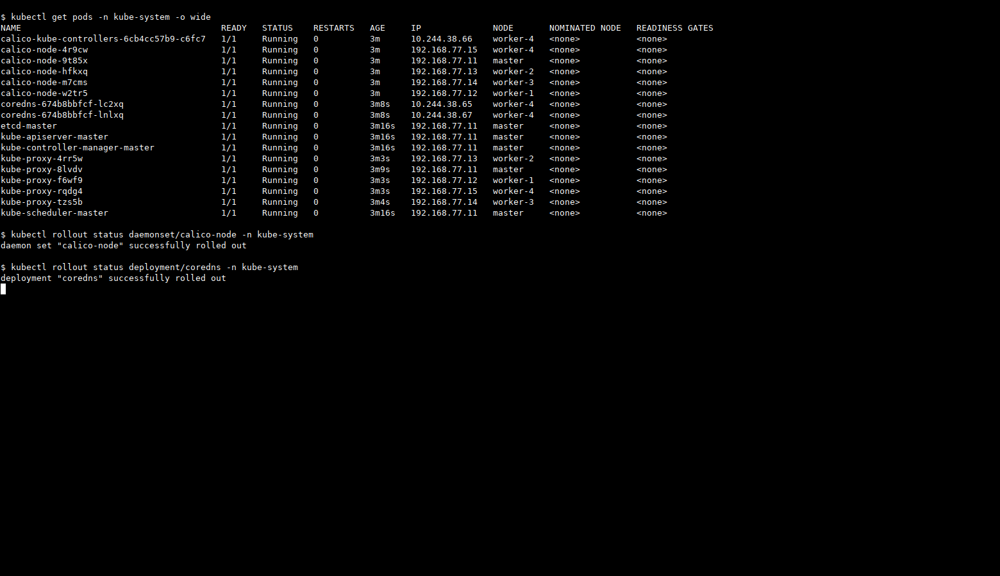
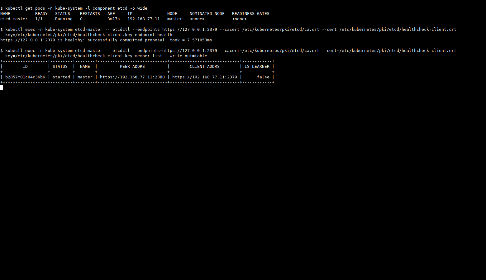

# Домашнее задание «Установка Kubernetes»

Установил кластер через `kubeadm`: один master и четыре worker. На всех пяти VM стоит Ubuntu 20.04.6 LTS, контейнеры запускает containerd. etcd работает на master как static Pod.

## Стенд

| Нода | Адрес учебной сети | vCPU | RAM | Роль |
|---|---|---:|---:|---|
| master | 192.168.77.11 | 2 | 3 GiB | control-plane, etcd |
| worker-1 | 192.168.77.12 | 2 | 2 GiB | worker |
| worker-2 | 192.168.77.13 | 2 | 2 GiB | worker |
| worker-3 | 192.168.77.14 | 2 | 2 GiB | worker |
| worker-4 | 192.168.77.15 | 2 | 2 GiB | worker |

Это отдельные локальные QEMU/KVM VM, не пять контейнеров с общей ОС. У каждой два интерфейса: NAT для загрузки пакетов и `lan0` для общения нод. Между собой они используют адреса `192.168.77.0/24`. Для kubelet явно задал адрес `lan0`, чтобы одинаковый NAT-адрес `10.0.2.15` не попал в InternalIP.

Версии, с которыми выполнил работу:

- Kubernetes, kubeadm, kubelet, kubectl — **1.33.13**;
- containerd — **1.7.24**;
- Calico — **3.30.4**;
- ядро — **5.15.0-139-generic**, cgroup v2;
- Pod CIDR — `10.244.0.0/16`, Service CIDR — `10.96.0.0/12`.

Исходно в образе Ubuntu было ядро 5.4. Установил HWE 5.15, включил cgroup v2 и использовал `systemd` как cgroup driver в containerd и kubelet. Swap отключён.

## Подготовка и установка

Для подготовки нод использовал [prepare-node.sh](prepare-node.sh). Скрипт предназначен **для гостевых Ubuntu 20.04 VM**, а не для запуска на рабочем компьютере. Он устанавливает containerd и пакеты Kubernetes, настраивает модули ядра, sysctl и cgroups. После подготовки VM загрузил с новым ядром.

Конфигурация первого узла — [kubeadm.yaml](kubeadm.yaml). В ней указан локальный etcd, адрес master и используемые подсети.

На master:

```bash
sudo kubeadm config validate --config kubeadm.yaml
sudo kubeadm init --config kubeadm.yaml
mkdir -p "$HOME/.kube"
sudo cp /etc/kubernetes/admin.conf "$HOME/.kube/config"
sudo chown "$(id -u):$(id -g)" "$HOME/.kube/config"
```

Четыре worker присоединил через `kubeadm join`. Команду подключения получил на master через `sudo kubeadm token create --print-join-command`; её действующий токен и приватные конфиги в репозиторий не включал. На каждом worker перед подключением указал собственный `--node-ip` в `/etc/default/kubelet` и использовал CRI socket `unix:///run/containerd/containerd.sock`.

Для Calico подготовил [Kustomize-конфигурацию](calico/kustomization.yaml). Она берёт манифест закреплённой версии, задаёт Pod CIDR и выбор адреса ноды через `kubernetes-internal-ip`:

```bash
kubectl apply --server-side -k calico
kubectl wait --for=condition=Ready node --all --timeout=180s
```

Метки `node-role.kubernetes.io/worker` добавил четырём рабочим нодам. На master оставил стандартный control-plane taint.

## Проверка нод

Все пять нод получили `Ready`. В выводе видны один control-plane, четыре worker, Ubuntu 20.04.6 и `containerd://1.7.24`. Дополнительно проверил ёмкость нод и `/readyz` API-сервера — ответ `ok`.



## Системные компоненты и сеть

Проверил Pod'ы `kube-system` и завершение rollout Calico и CoreDNS. На каждой ноде работает по одному `calico-node` и `kube-proxy`; API-сервер, controller-manager и scheduler находятся на master.



При проверке `crictl info` containerd вернул `RuntimeReady: true` и `NetworkReady: true`. На этом же кластере затем развернул приложения и проверил межнодовые соединения в [следующей работе о сетевых политиках](../kubernetes-09/README.md).

## etcd на master

В кластере один Pod `etcd-master`, он запущен именно на master. Через `etcdctl` проверил здоровье endpoint и список участников: один участник `master`, состояние `started`, endpoint здоров.



Выполнил обязательный вариант с одним master. Дополнительное задание со звёздочкой про HA в эту работу не включал: данный кластер не является отказоустойчивым по control-plane.

## Файлы

- [prepare-node.sh](prepare-node.sh) — подготовка гостевых Ubuntu VM;
- [kubeadm.yaml](kubeadm.yaml) — конфигурация control-plane и kubelet;
- [calico/kustomization.yaml](calico/kustomization.yaml) — установка Calico;
- [screenshots](screenshots) — результаты реальной проверки.
