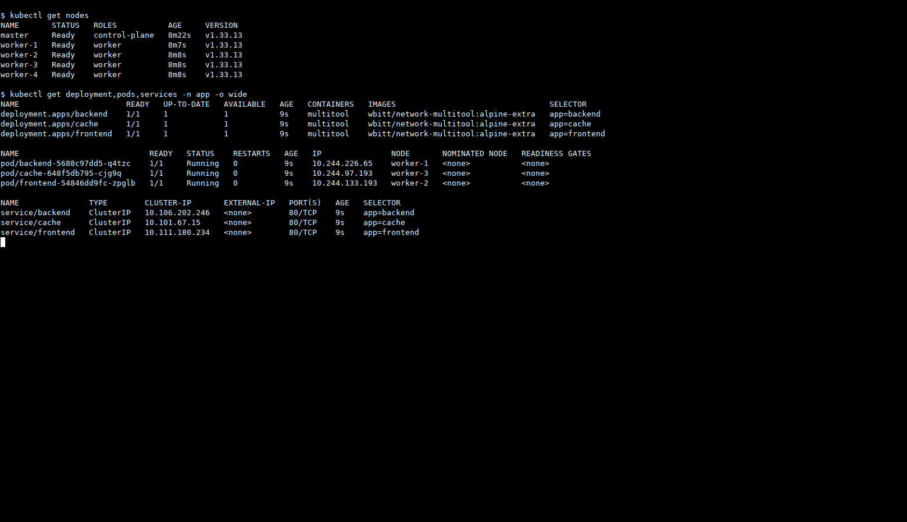
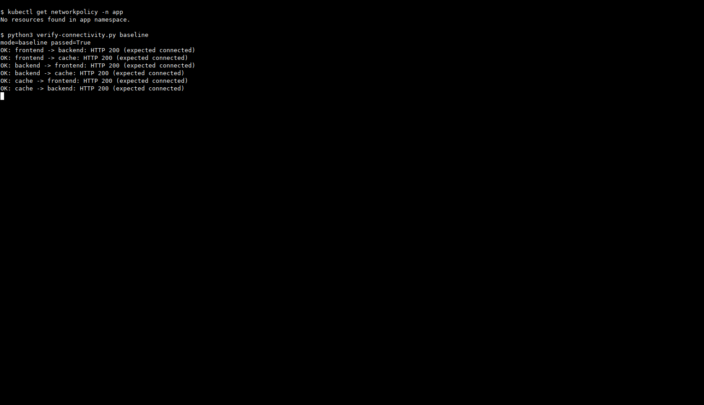
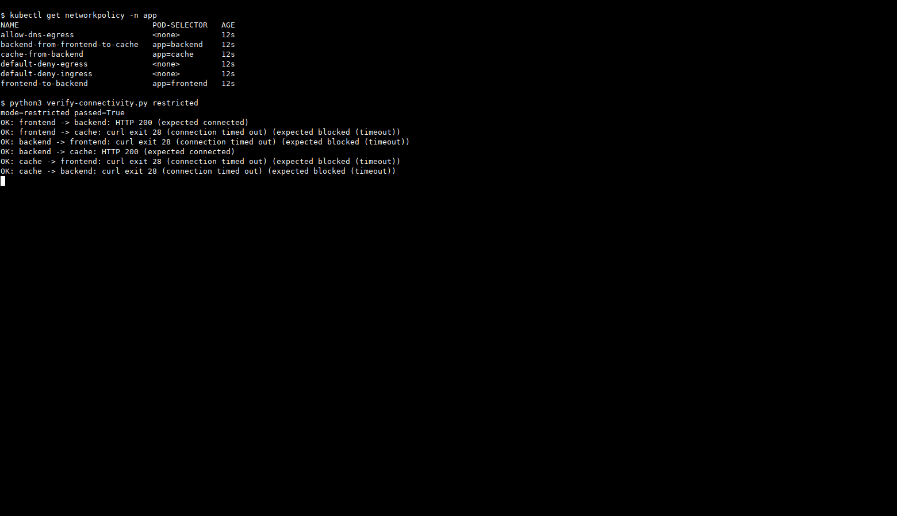

# Домашнее задание «Как работает сеть в K8s»

Развернул `frontend`, `backend` и `cache` и ограничил доступ между ними через NetworkPolicy. Использовал кластер из [предыдущей работы](../kubernetes-08/README.md): пять Ubuntu 20.04 VM, containerd и Calico 3.30.4.

## Приложения и Service

Манифесты — [apps.yaml](apps.yaml). Для каждого приложения создал отдельный Deployment с `wbitt/network-multitool:alpine-extra` и ClusterIP Service на порту 80. Namespace назвал `app`: имена namespace в Kubernetes записываются в нижнем регистре.

Добавил HTTP readiness probe и pod anti-affinity. Три приложения разместились на разных рабочих нодах, поэтому проверки проходят через межнодовую сеть:

- frontend — worker-2;
- backend — worker-1;
- cache — worker-3.

```bash
kubectl apply -f apps.yaml
kubectl rollout status deployment/frontend -n app
kubectl rollout status deployment/backend -n app
kubectl rollout status deployment/cache -n app
kubectl get deployment,pods,services -n app -o wide
```



## Проверка до ограничений

Сначала проверил все шесть направлений между приложениями без политик: каждое соединение вернуло HTTP 200. Это важно, чтобы потом не принять неработающий Service или приложение за результат блокировки.

Для проверки написал [verify-connectivity.py](verify-connectivity.py). Он выполняет запросы из самих Pod через `kubectl exec`. Перед каждым HTTP-запросом отдельно проверяет DNS и сверяет полученный адрес с ClusterIP нужного Service. Ошибка DNS, неготовый Pod или ошибка `kubectl` не считаются успешной блокировкой.

```bash
python3 verify-connectivity.py baseline
```



Исходный результат: [results/baseline.json](results/baseline.json).

## Сетевые политики

В [network-policies.yaml](network-policies.yaml) создал шесть политик:

- `default-deny-ingress` и `default-deny-egress` закрывают входящий и исходящий трафик всех Pod в `app`;
- `frontend-to-backend` разрешает исходящий TCP/80 из frontend в backend;
- `backend-from-frontend-to-cache` разрешает backend принимать TCP/80 от frontend и обращаться по TCP/80 к cache;
- `cache-from-backend` разрешает cache принимать TCP/80 только от backend;
- `allow-dns-egress` — техническое исключение: UDP/TCP 53 к Pod CoreDNS с меткой `k8s-app: kube-dns` в `kube-system`.

Таким образом, для нового межприложенческого HTTP-соединения одновременно разрешены нужный исходящий трафик источника и входящий трафик получателя. Ответ на разрешённое соединение не является новым обратным соединением: например, backend отвечает frontend, но сам начать HTTP-соединение с frontend не может.

```bash
kubectl apply --dry-run=server -f network-policies.yaml
kubectl apply -f network-policies.yaml
python3 verify-connectivity.py restricted
```

## Результат

| Направление | До политик | После политик |
|---|---|---|
| frontend → backend | HTTP 200 | HTTP 200 |
| frontend → cache | HTTP 200 | Таймаут, curl 28 |
| backend → frontend | HTTP 200 | Таймаут, curl 28 |
| backend → cache | HTTP 200 | HTTP 200 |
| cache → frontend | HTTP 200 | Таймаут, curl 28 |
| cache → backend | HTTP 200 | Таймаут, curl 28 |

После применения политик остались доступны только **frontend → backend → cache**. В остальных четырёх направлениях TCP-соединение не установилось за заданный таймаут. DNS при этом продолжал работать.



Исходный результат: [results/restricted.json](results/restricted.json).

Чтобы проверить причину блокировки, дополнительно удалил только эти политики и повторил запросы: все шесть направлений снова вернули HTTP 200. Затем применил политики обратно — снова два разрешённых и четыре заблокированных направления. Pod за это время не пересоздавались, их UID остались теми же. Контрольные результаты: [после удаления политик](results/policy-removal-control.json) и [после повторного применения](results/policy-reapply-control.json).

В конце все три Pod оставались `1/1 Running`, а оба YAML прошли серверный dry-run. Политики ограничивают обычный трафик Pod; это не изоляция от администратора кластера, доступа через `kubectl exec` или трафика kubelet с самой ноды.

## Файлы

- [apps.yaml](apps.yaml) — namespace, Deployment и Service;
- [network-policies.yaml](network-policies.yaml) — default deny и разрешения;
- [verify-connectivity.py](verify-connectivity.py) — повторяемая проверка всех шести направлений;
- [results](results) — результаты четырёх реальных прогонов;
- [screenshots](screenshots) — скриншоты команд и проверок.
