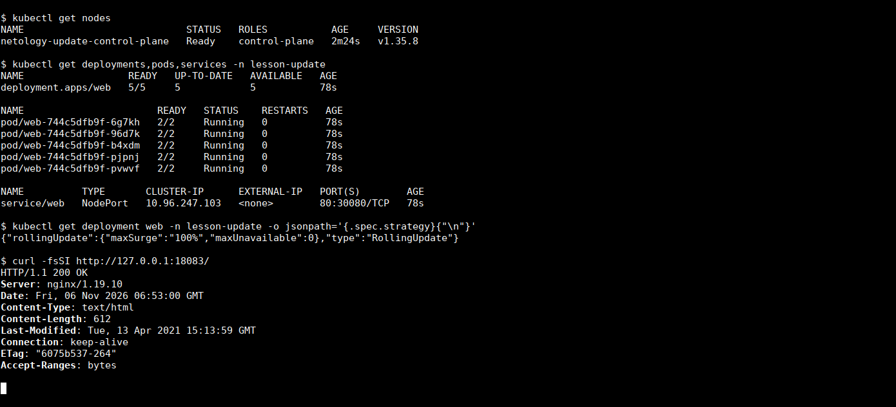
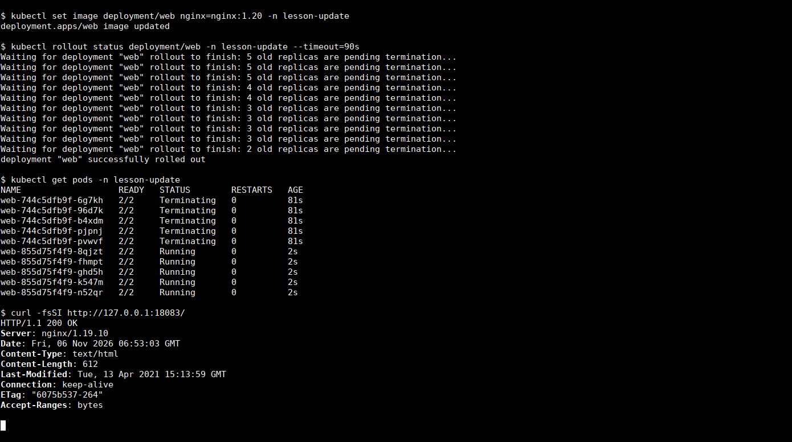
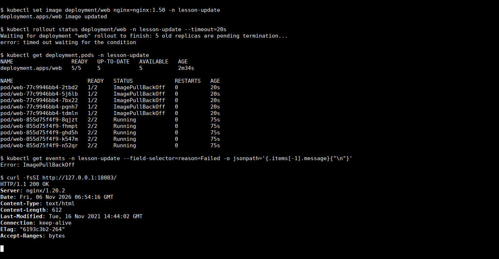
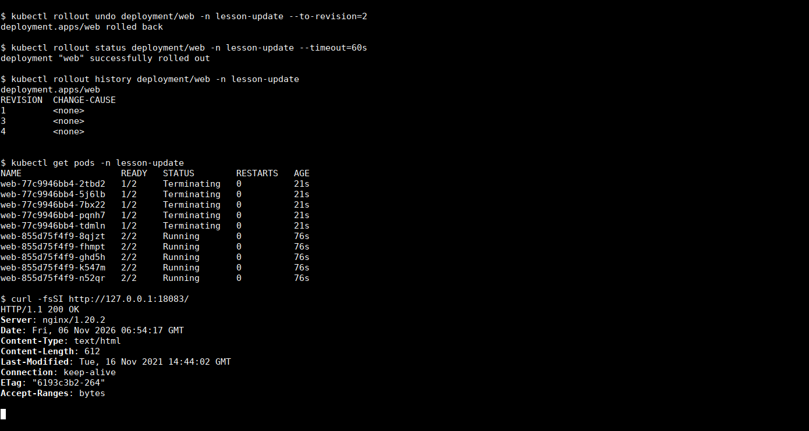
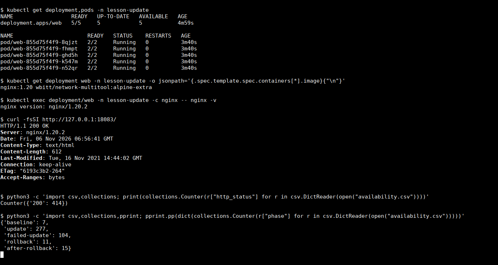

# Домашнее задание «Обновление приложений»

## Задание 1. Выбор стратегии

Выбрал бы `Recreate`. Обновление мажорное, старые и новые версии не могут работать вместе. RollingUpdate и Canary оставляют обе версии работающими одновременно, поэтому здесь они не подходят.

Запаса в 20% недостаточно, чтобы рядом развернуть полноценную вторую копию приложения для Blue/Green, если потребление новой версии сопоставимо со старой. Кроме того, переключение трафика само по себе не решает совместимость общей базы данных или форматов сообщений.

При Recreate Deployment сначала останавливает Pod старой версии и дожидается их завершения, затем запускает новые. Одновременной работы двух версий не будет, и удваивать ресурсы не нужно. Цена этого решения — плановый простой на время запуска и проверки новых Pod. Нулевой простой при заданных условиях обещать нельзя.

```yaml
strategy:
  type: Recreate
```

Перед таким обновлением нужны согласованное окно, резервная копия данных и проверенный план миграции. Возврат старого образа сам по себе не откатит несовместимые изменения схемы БД.

## Задание 2. Обновление Deployment

Для практики поднял одноразовый локальный kind-кластер с Kubernetes `v1.35.8`. В namespace `lesson-update` создал Deployment `web` из пяти реплик. В каждом Pod два контейнера: nginx `1.19` и `wbitt/network-multitool:alpine-extra`.

Манифесты:

- [deployment.yaml](deployment.yaml) — исходные пять реплик с nginx `1.19`;
- [service.yaml](service.yaml) — NodePort Service для доступа к nginx.

У multitool задал `HTTP_PORT=8080` и `HTTPS_PORT=8443`, чтобы не занимать порты nginx. HTTP readinessProbe есть у обоих контейнеров. NodePort `30080` проброшен средствами kind на `127.0.0.1:18083`, поэтому проверку делал с хоста, без `kubectl port-forward`.

### Исходное состояние

```bash
kubectl create namespace lesson-update
kubectl apply -n lesson-update -f deployment.yaml -f service.yaml
kubectl rollout status deployment/web -n lesson-update
kubectl get pods -n lesson-update
curl -fsSI http://127.0.0.1:18083/
```

Все пять Pod получили `2/2 Running`. На HTTP-запрос отвечает nginx `1.19.10`.



### Обновление до 1.20

Это отдельный сценарий, не мажорное несовместимое приложение из задания 1. Для nginx использовал RollingUpdate:

```yaml
strategy:
  type: RollingUpdate
  rollingUpdate:
    maxSurge: 100%
    maxUnavailable: 0
```

Так пять новых Pod могут создаваться параллельно, а число доступных реплик не должно опускаться ниже пяти. Для этого на тестовом стенде предусмотрены ресурсы ещё на пять Pod. Запас 20% из первого задания здесь не предполагаю: если это общее ограничение для обоих сценариев, `maxSurge` нужно уменьшить до `20%`, то есть одной дополнительной реплики, и обновление займёт больше времени.

Образ `1.20` заранее скачал в containerd ноды, чтобы во время rollout не ждать загрузки. `minReadySeconds` оставил равным нулю. У nginx добавил `preStop` с паузой три секунды и grace period десять секунд: при завершении Pod процесс ещё немного обслуживает запросы, пока обновляются маршруты Service.

```bash
kubectl set image deployment/web nginx=nginx:1.20 -n lesson-update
kubectl rollout status deployment/web -n lesson-update --timeout=90s
```

Новые Pod стали готовы, rollout завершился. Во время переключения HTTP-проверка видела обе версии: `1.19.10` и `1.20.2`.

На скриншоте ниже старые Pod ещё в `Terminating`, и один запрос после `rollout status` попал в старую версию. Проверкой одной команды здесь не ограничился: дождался удаления старых Pod, затем отдельно проверил итоговый образ и версию nginx во всех пяти контейнерах. Финальное состояние показано в конце отчёта.



### Несуществующая версия

Попытался установить `nginx:1.50`:

```bash
kubectl set image deployment/web nginx=nginx:1.50 -n lesson-update
kubectl rollout status deployment/web -n lesson-update --timeout=20s
```

Ожидание завершилось по таймауту. Образ действительно отсутствует: containerd вернул `not found`, новые Pod перешли в `ImagePullBackOff`. Это не то же самое, что автоматический откат: Deployment сам не вернул предыдущий образ.

У новых Pod готов только multitool, поэтому их статус `1/2`, и они не становятся готовыми endpoints Service. Благодаря `maxUnavailable: 0` пять рабочих Pod nginx `1.20` остались запущены. HTTP продолжил возвращать `200 OK`, в заголовке Server — `nginx/1.20.2`.



### Откат

Успешное обновление до `1.20` было ревизией 2. Вернулся к ней явно:

```bash
kubectl rollout undo deployment/web -n lesson-update --to-revision=2
kubectl rollout status deployment/web -n lesson-update --timeout=60s
kubectl rollout history deployment/web -n lesson-update
```

Ошибочные Pod удалились, шаблон Deployment снова содержит `nginx:1.20`. Откат получил новую ревизию 4; номер 2 не остаётся текущим номером ревизии после rollback.



### Проверка доступности

С хоста выполнял HTTP GET примерно каждые 0,2 секунды, с таймаутом две секунды и новым соединением для каждого запроса. Проверял не только код `200`, но и наличие `Welcome to nginx!` в теле ответа. Запросы шли до обновления, во время обоих rollout и отката.

Полный журнал: [availability.csv](availability.csv).

| Этап | Запросов | HTTP 200 с ожидаемой страницей | Ошибок |
| --- | ---: | ---: | ---: |
| До обновления | 7 | 7 | 0 |
| Обновление и работа 1.20 | 277 | 277 | 0 |
| Несуществующий образ | 104 | 104 | 0 |
| Откат | 11 | 11 | 0 |
| После отката | 15 | 15 | 0 |
| **Всего** | **414** | **414** | **0** |

Это результат наблюдения с указанным интервалом, а не гарантия отсутствия сбоя любой длительности. В конце осталось ровно пять Pod `2/2 Running`, без перезапусков. В каждом контейнере nginx проверил `nginx -v`: версия `1.20.2`. Оба YAML прошли серверный dry-run.



Исходный манифест намеренно содержит `1.19`, чтобы повторить весь сценарий. Успешная конечная версия после обновления и отката — `1.20`.

### Источники

- [Kubernetes: Updating a Deployment](https://kubernetes.io/docs/concepts/workloads/controllers/deployment/#updating-a-deployment).
- [Стратегии обновления приложений](https://habr.com/ru/companies/flant/articles/471620/).
